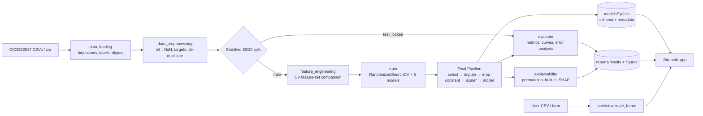
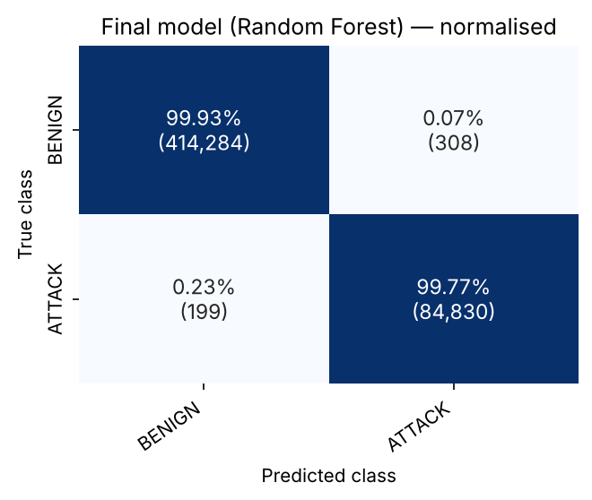
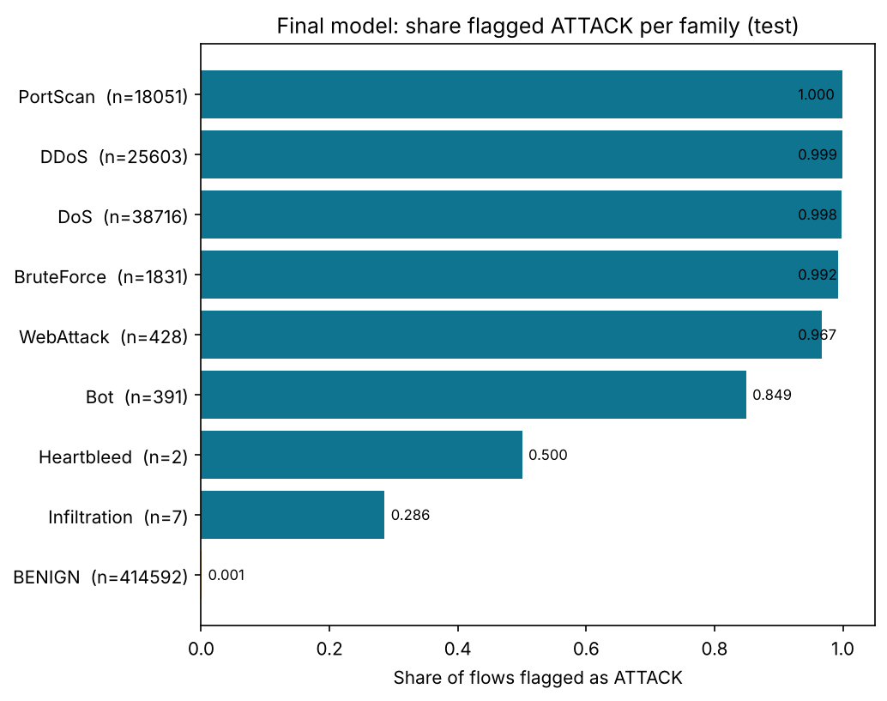
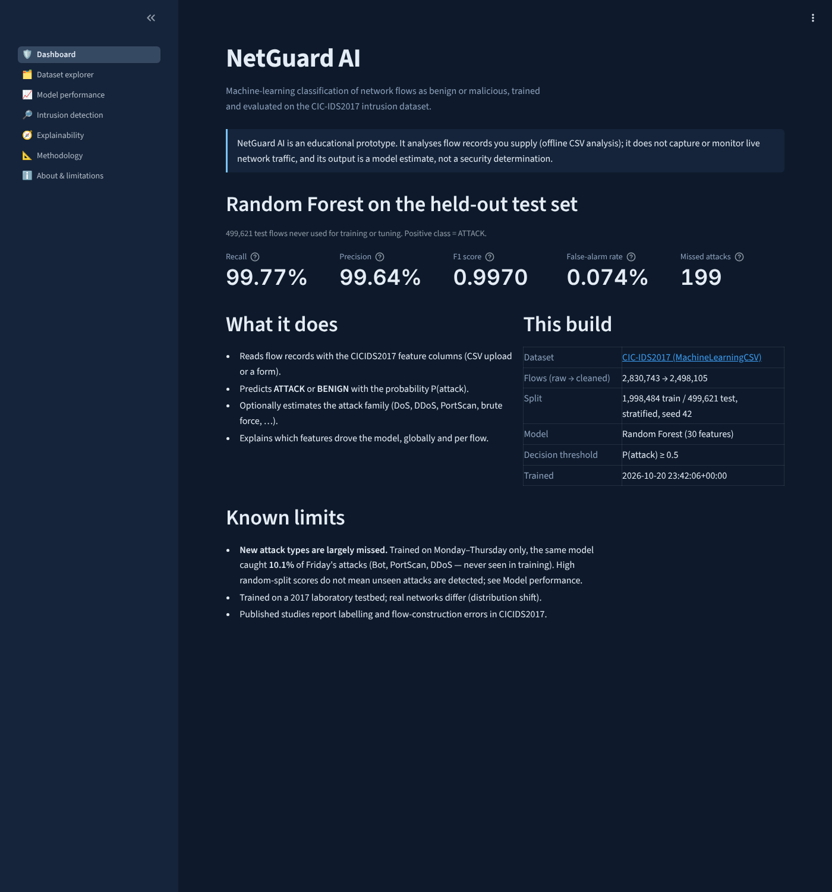
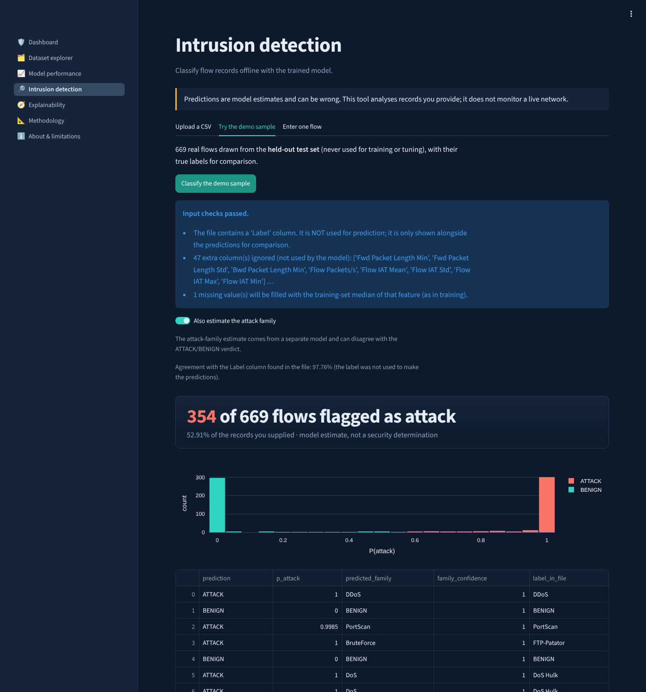
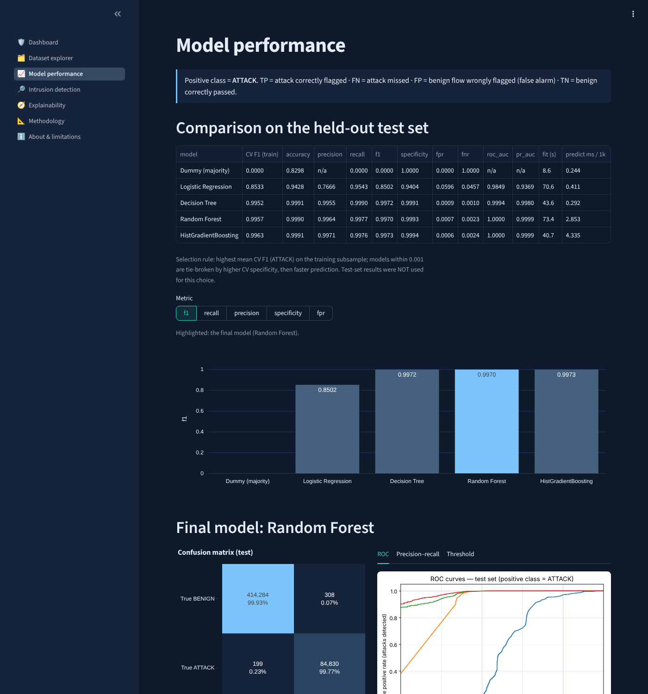
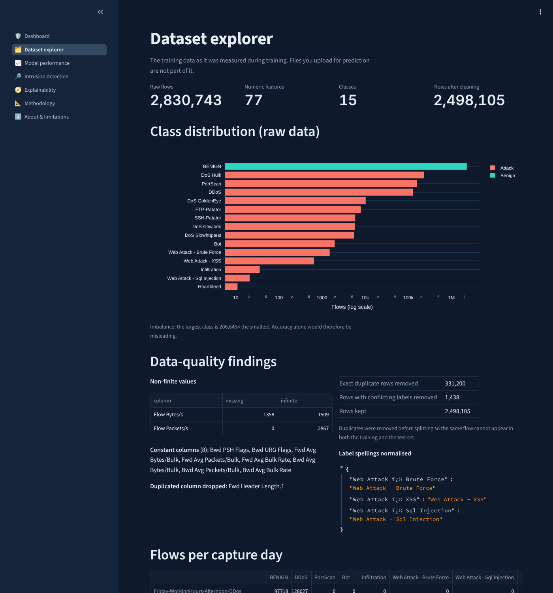

# NetGuard AI

**Machine Learning-Based Network Intrusion Detection and Attack Classification System**

NetGuard AI classifies network flow records as **benign** or **malicious** and estimates the
attack family. It uses classical scikit-learn models trained on the **CIC-IDS2017** dataset. A
Streamlit website presents the dataset, the evaluation and explanations, and includes an offline
detection tool.

**Live demo:** https://netguard-ai.streamlit.app · **Code:** https://github.com/Karmanya-Singh30/NetGuard-AI

> **Academic prototype.** NetGuard AI analyses flow records that you supply (CSV upload or a form).
> It does **not** capture or monitor live traffic, and it is not a replacement for a firewall, IPS
> or professional security monitoring. Its predictions are model estimates.

---

## Contents
- [Quick start](#quick-start)
- [Features](#features)
- [System architecture](#system-architecture)
- [Setup](#setup)
  - [1. Python and virtual environment](#1-python-and-virtual-environment)
  - [2. Get the dataset](#2-get-the-dataset)
  - [3. Train and evaluate](#3-train-and-evaluate)
  - [4. Run the website](#4-run-the-website)
  - [5. Run the tests](#5-run-the-tests)
- [Results](#results)
- [Explainability](#explainability)
- [Limitations](#limitations)
- [Project structure](#project-structure)
- [Further documentation](#further-documentation)
- [Future scope](#future-scope)
- [SDG contribution](#sdg-contribution)
- [References](#references)

## Quick start
```bash
python -m venv .venv
# activate it (see Setup), then:
pip install -r requirements.txt
python -m pytest -q                 # works without the dataset
python -m src.train                 # needs the CIC-IDS2017 CSVs in data/raw/ or data/
streamlit run app/app.py
```

## Features
| Implemented | Not implemented (out of scope) |
|---|---|
| Binary ATTACK/BENIGN detection with P(attack) | Live packet capture or monitoring |
| Attack-family estimate (DoS, DDoS, PortScan, BruteForce, WebAttack, Bot, Infiltration, Heartbleed) | Turning pcap files into flows (use CICFlowMeter) |
| CSV upload with schema validation and downloadable results | Automatic blocking / prevention |
| Single-flow form with range warnings and a per-flow explanation | User accounts, databases, cloud hosting |
| Dataset explorer, model comparison, error analysis, held-out-day test | |
| Permutation importance, built-in importance, SHAP (tree models) | |

## System architecture



\*Scaling is used only for logistic regression. Training and inference are separate: the website
only **loads** saved artifacts. It never trains and contains no hard-coded results. A static
diagram is in [`docs/architecture.png`](docs/architecture.png).

## Setup

### 1. Python and virtual environment
Python **3.11 or newer** is required (pandas 3). The pinned versions in
[`requirements.txt`](requirements.txt) were verified with Python 3.12 (Windows) and 3.13 (Linux).

**Windows (PowerShell)**
```powershell
python -m venv .venv
.\.venv\Scripts\Activate.ps1
python -m pip install --upgrade pip
pip install -r requirements.txt
```
If PowerShell refuses to run `Activate.ps1`, run
`Set-ExecutionPolicy -Scope CurrentUser RemoteSigned` once and answer `Y`.

**macOS / Linux**
```bash
python3 -m venv .venv
source .venv/bin/activate
python -m pip install --upgrade pip
pip install -r requirements.txt
```

A step-by-step Windows walkthrough is in [`docs/RUN_ON_LAPTOP.md`](docs/RUN_ON_LAPTOP.md).

### 2. Get the dataset
**CIC-IDS2017**, MachineLearningCSV release, Canadian Institute for Cybersecurity (UNB):
https://www.unb.ca/cic/datasets/ids-2017.html

Download `MachineLearningCSV.zip` (8 CSV files, one per capture session). When no `--data` path
is given, `src/data_loading.py` searches in this order and uses the first match:

1. `data/raw/*.csv` (recommended)
2. `data/*.csv`
3. `data/raw/MachineLearningCSV.zip` (read directly, no unzipping needed)
4. `data/MachineLearningCSV.zip`

The raw data is not part of the repository. Binary target: ATTACK for any `Label` other than
BENIGN. Family target: `FAMILY_MAP` in [`src/config.py`](src/config.py). Known dataset issues:
[`data/dataset_summary.md`](data/dataset_summary.md).

### 3. Train and evaluate
```bash
python -m src.train                                      # full run, data found automatically
python -m src.train --data path/to/MachineLearningCSV.zip  # a folder, one CSV or the zip
python -m src.train --max-train-rows all                 # 'auto' (default), 'all' or a number
python -m src.train --quick                              # smoke test only, not reportable
```

Other options: `--tune-rows` (CV tuning subsample, default 200,000), `--n-jobs` (cores for
Random Forest, default -1), `--skip-eda`, `--skip-holdout`, `--skip-multiclass`. With
`--max-train-rows auto`, machines with less than 12 GB RAM fit the final models on a
1,000,000-row stratified subsample (rare classes kept in full); otherwise all training rows are
used.

One command runs the whole pipeline and writes:

| Step | Output |
|---|---|
| Profile, clean, de-duplicate | `reports/results/dataset_profile.json`, `cleaning_report.json` |
| EDA figures | `reports/figures/eda_*.png` |
| Split and feature-set comparison (CV) | `split_info.json`, `feature_selection.json` |
| Tune + fit 5 models, evaluate on test | `model_comparison.csv/.json`, `cv_search_*.csv`, `cm_*.png`, `roc_curves.png`, `pr_curves.png`, `model_comparison.png` |
| Error analysis | `error_analysis.json`, `detection_by_family.png`, `threshold_sweep.png` |
| Explainability | `explainability.json`, `importance_*.png` |
| Attack-family model | `multiclass_results.json`, `cm_multiclass_*.png` |
| Held-out day (train Mon–Thu, test Fri) | `holdout_day_results.json`, `holdout_day_detection.png` |
| Artifacts | `models/final_pipeline.joblib`, `multiclass_pipeline.joblib`, `feature_schema.json`, `model_metadata.json`, `models/candidates/*.joblib`, `data/samples/demo_traffic_sample.csv` |
| Summary | `reports/results/results_summary.md` |

Methodology and maths: [`docs/METHODOLOGY.md`](docs/METHODOLOGY.md).

### 4. Run the website
```bash
streamlit run app/app.py
```
The app opens at http://localhost:8501 with the dark theme and 200 MB upload limit set in
[`.streamlit/config.toml`](.streamlit/config.toml). It needs the trained artifacts in `models/`.

| Page | Contents |
|---|---|
| Dashboard | Purpose, dataset, selected model, test metrics, disclaimer |
| Dataset explorer | Profile, class distribution, data-quality findings, EDA figures, feature reference |
| Model performance | Comparison table, confusion matrix, ROC/PR, threshold analysis, error analysis, family model, held-out day |
| Intrusion detection | CSV upload, demo sample from the test set, single-flow form; CSV download |
| Explainability | Permutation, built-in and SHAP importance with caveats |
| Methodology | Pipeline, feature selection, metric definitions, reproducibility |
| About & limitations | Objectives, users, SDGs, scope, limitations, future work |

**Example workflow:** open *Intrusion detection* → *Try the demo sample* → *Classify the demo
sample*. To use your own data, download the empty template, fill it with CICFlowMeter features
and upload it (up to 200,000 rows).

**Input-realism check.** Every prediction run compares the records with the training data. It
looks for values outside anything seen in training (including a non-0/1 `PSH Flag Count`) and for
rows with 5+ features in the extreme 1 % tails. If a file does not look like real CICFlowMeter
traffic, the page warns and marks each row in an `input_check` column. The check is calibrated on
real data: 2 of 499,621 real held-out flows trip the range test, while hand-made or random rows
usually do. Predictions on such rows are not meaningful. Test the model with real flows, such as
the demo sample, instead.

### 5. Run the tests
```bash
python -m pytest -q                 # full suite (uses a synthetic fixture, no dataset needed)
python -m pytest -q -m "not slow"   # skip the end-to-end train + website test
```
Configuration is in [`pytest.ini`](pytest.ini). The suite covers loading and label
normalisation, inf/NaN handling, de-duplication, split integrity and stratification, leakage
guards (training-only scaler statistics, in-fold SMOTE, excluded columns), save/reload,
prediction shape and probability range, CSV validation, the input-realism check, and an end-to-end run that trains on
[`tests/synthetic_data.py`](tests/synthetic_data.py) and executes every website page. The
fixture mimics the CIC-IDS2017 *format* only; its scores are meaningless.

## Results
All numbers below come from [`models/model_metadata.json`](models/model_metadata.json) and the
figures in [`reports/figures/`](reports/figures/). The full per-model tables
(`reports/results/*.json`, `results_summary.md`) are regenerated by `python -m src.train`.

**Run.** Full dataset, seed 42, all 1,998,484 training rows used for fitting (199,995 for CV
tuning), 9.7 minutes on a Lenovo LOQ laptop (Intel Core i5, 24 GB RAM, Windows 11); Python 3.12.4,
scikit-learn 1.9.1. An independent run on a 2-core Linux machine produced the identical final model
and test results.

**Data.** 2,830,743 flows loaded; **2,498,105** remain after removing duplicates and
label-conflicting rows. The stratified 80/20 split gives 1,998,484 training and **499,621 test**
flows. Cross-validation chose the **top 30 features by random-forest importance**.

**Model selection (CV F1 of ATTACK on the training subsample):**

| Model | CV F1 |
|---|---:|
| Logistic Regression | 0.8545 |
| Decision Tree | 0.9952 |
| **Random Forest (final)** | 0.9957 |
| HistGradientBoosting | 0.9963 |

**Selection rule** (from the metadata): highest mean CV F1; models within 0.001 are tie-broken by
higher CV specificity, then faster prediction. HistGradientBoosting and Random Forest were within
0.001, and Random Forest won the tie-break. Test-set results were not used for this choice.
Final hyperparameters: `min_samples_leaf=2`, `max_features="sqrt"`, `max_depth=None`,
`class_weight="balanced_subsample"`, threshold 0.5.

**Final model on the test set (positive class = ATTACK):**

| Precision | Recall | F1 | Specificity | FPR | FNR | ROC-AUC | PR-AUC | Accuracy |
|---:|---:|---:|---:|---:|---:|---:|---:|---:|
| 0.9964 | 0.9977 | 0.9970 | 0.9993 | 0.00074 | 0.0023 | 0.99996 | 0.99985 | 0.9990 |

It missed **199** of 85,029 test attacks and raised **308** false alarms on 414,592 benign flows.
Since 83 % of test flows are benign, a model that always predicts BENIGN would already reach about
83 % accuracy while detecting nothing, which is why accuracy is not used to judge models.

**Where it fails** ([`detection_by_family.png`](reports/figures/detection_by_family.png)):
detection is ≥ 99.2 % for PortScan, DDoS, DoS and brute force, 96.7 % for web attacks and 84.9 %
for Bot. Only 2 of 7 Infiltration and 1 of 2 Heartbleed test flows were detected; these classes
are too rare to evaluate reliably.

**Attack families** ([`cm_multiclass_normalised.png`](reports/figures/cm_multiclass_normalised.png)):
per-family recall is ≥ 99.5 % for all common families and 98.2 % for Bot. Bot precision is
weak: 356 benign flows were predicted as Bot against 384 true Bot flows.

**Held-out day, the key limitation.** Trained on Monday–Thursday and tested on Friday (615,293
flows, whose Bot, PortScan and DDoS attacks are unseen in training), the same approach reaches
**recall 0.101** at precision 0.995 and FPR 0.0003 (F1 0.184, ROC-AUC 0.768). Random-split scores
therefore measure recognition of *known* attack types, not detection of new ones.

| | |
|---|---|
|  |  |

Other figures: per-model confusion matrices `reports/figures/cm_*.png` and EDA plots
`reports/figures/eda_*.png`. The comparison, ROC/PR, threshold, importance and held-out-day plots
are written to the same folder by a full training run.

### Screenshots
| | |
|---|---|
|  |  |
|  |  |

More in [`docs/screenshots/`](docs/screenshots/): single-flow form, explainability,
methodology and about pages.

## Explainability
- **Permutation importance** on the test set: the drop in F1 when a feature is shuffled.
- **Built-in importance**: impurity decrease for trees, coefficients for logistic regression.
- **Per-flow explanations**: SHAP for tree models, exact coefficient × value for logistic
  regression.

Rankings are saved to `reports/results/explainability.json` and shown on the website.
Importance shows what the model relies on, not what causes an attack.

## Limitations
- **Dataset:** 2017 laboratory traffic; documented labelling errors; attack types tied to
  capture days; some classes (Infiltration, Heartbleed, SQL injection) have very few flows.
- **Evaluation:** random-split scores measure recognition of *known* attack types. The
  held-out-day experiment (recall 0.101) shows how much harder unseen attacks are.
- **Inputs:** flows must be computed the way CICFlowMeter does. Features from other tools, or
  hand-made/synthetic rows, will not match (the website warns when this is detected). `Destination Port` is deliberately excluded as a likely testbed shortcut.
- **Scope:** offline only; no live capture, prevention or alert management.
- **Explanations** describe the model, not causation.

## Project structure
```
network-intrusion-detection/
├── README.md · requirements.txt · pytest.ini
├── .streamlit/config.toml          theme, upload limit
├── app/app.py · app/components.py  website (reads artifacts only)
├── src/
│   ├── config.py                   paths, seed, labels, families
│   ├── data_loading.py             CSV/zip discovery and reading, header & label normalisation
│   ├── data_preprocessing.py       inf handling, targets, de-duplication, split, preprocessor
│   ├── feature_engineering.py      ColumnSelector, correlation filter, MI, feature-set CV
│   ├── train.py                    end-to-end training & evaluation CLI
│   ├── evaluate.py                 metrics and plots
│   ├── predict.py                  artifact loading, input validation, inference
│   ├── explainability.py           importance, permutation, SHAP / linear contributions
│   └── eda.py                      dataset profile and EDA figures
├── notebooks/                      01 exploration, 02 modelling (call src/), build_notebooks.py
├── tests/                          pytest suite + synthetic fixture generator
├── data/                           raw/ · samples/ · dataset_summary.md
├── models/                         final + multiclass pipelines, schema, metadata
├── reports/                        figures/ · results/ · project_report.md
└── docs/                           methodology, run guide, screenshots, architecture diagram
```

## Further documentation
| File | Contents |
|---|---|
| [`docs/RUN_ON_LAPTOP.md`](docs/RUN_ON_LAPTOP.md) | Windows step-by-step setup and training |
| [`docs/METHODOLOGY.md`](docs/METHODOLOGY.md) | Preprocessing, feature selection, models, metrics |
| [`docs/VIVA_QUESTIONS.md`](docs/VIVA_QUESTIONS.md) | Viva preparation |
| [`reports/project_report.md`](reports/project_report.md) | Project report (Markdown version of the submitted report) |

## Future scope
Live flow extraction feeding the model; evaluation on newer datasets (e.g. CSE-CIC-IDS2018,
UNSW-NB15) and cross-dataset tests; drift monitoring; thresholds chosen from analyst costs;
anomaly detection for unseen attacks; probability calibration.

## SDG contribution
- **SDG 9 — Industry, Innovation and Infrastructure:** explores ML support for detecting malicious
  traffic as part of more resilient digital infrastructure.
- **SDG 16 — Peace, Justice and Strong Institutions:** supports cybersecurity awareness and safer
  digital environments.

These are potential contributions of an educational prototype, not measured impacts.

## Reproducibility
Seed 42 everywhere; pinned `requirements.txt`; one command regenerates all results; each run
records library versions, settings and row counts in `models/model_metadata.json`.

## References
1. I. Sharafaldin, A. H. Lashkari, A. A. Ghorbani, "Toward Generating a New Intrusion Detection
   Dataset and Intrusion Traffic Characterization," *Proc. 4th ICISSP*, 2018, pp. 108–116.
   doi:10.5220/0006639801080116
2. G. Engelen, V. Rimmer, W. Joosen, "Troubleshooting an Intrusion Detection Dataset: the
   CICIDS2017 Case Study," *IEEE Security and Privacy Workshops (SPW)*, 2021.
   doi:10.1109/SPW53761.2021.00009
3. M. Lanvin, P.-F. Gimenez, Y. Han, F. Majorczyk, L. Mé, É. Totel, "Errors in the CICIDS2017
   Dataset and the Significant Differences in Detection Performances It Makes," *CRiSIS 2022*,
   LNCS 13857, Springer, 2023, pp. 18–33. doi:10.1007/978-3-031-31108-6_2
4. F. Pedregosa et al., "Scikit-learn: Machine Learning in Python," *JMLR* 12, 2011,
   pp. 2825–2830.
5. N. V. Chawla, K. W. Bowyer, L. O. Hall, W. P. Kegelmeyer, "SMOTE: Synthetic Minority
   Over-sampling Technique," *JAIR* 16, 2002, pp. 321–357.
6. L. Breiman, "Random Forests," *Machine Learning* 45(1), 2001, pp. 5–32.
7. S. M. Lundberg, S.-I. Lee, "A Unified Approach to Interpreting Model Predictions," *NeurIPS*,
   2017.

## Disclaimer
Built for academic assessment. Use only on data you are authorised to analyse.
