# Machine Learning-Based Network Intrusion Detection and Attack Classification System (NetGuard AI)

**Project report**

| | |
|---|---|
| Student | Karmanya Singh (PRN 24070126079) |
| Programme | B.Tech, Artificial Intelligence and Machine Learning |
| Guide | _[guide name]_ |
| Institution | Symbiosis Institute of Technology, Pune |
| GitHub | https://github.com/Karmanya-Singh30/NetGuard-AI |
| Live demo | https://netguard-ai.streamlit.app |
| Date | October 2026 |

> Every number in this report was produced by `python -m src.train` on the full CIC-IDS2017
> MachineLearningCSV data and can be traced to `reports/results/`. The course-template version of
> this report is `reports/NetGuard_AI_Report.docx`.

---

## Abstract

Network attacks are frequent, varied and costly, and analysts must triage large volumes of
traffic. This project builds and evaluates NetGuard AI, a machine-learning system that classifies
network flow records as benign or malicious and estimates the attack family. It uses the public
CIC-IDS2017 dataset (eight capture sessions, about 78 flow features per record). The pipeline
normalises headers and labels, replaces infinite values, and removes duplicate and
label-conflicting flows before a stratified 80/20 split. All learned preprocessing is fitted on
training data only, inside a scikit-learn pipeline. Four feature sets were compared by
cross-validation. A majority-class baseline, logistic regression, a decision tree, a random
forest and histogram gradient boosting were tuned with randomised search and compared on a
locked test set using precision, recall, F1, specificity, false-positive and false-negative
rates, ROC-AUC and PR-AUC. The final model, a **random forest** on 30 selected features, reached
**recall 0.9977, precision 0.9964, F1 0.9970 and a false-positive rate of 0.074 %** on 499,621
held-out test flows. A majority-class baseline scored 83.0 % accuracy while detecting nothing. A
held-out-day experiment (training on Monday–Thursday and testing on Friday's unseen Bot,
PortScan and DDoS traffic) reduced **recall to 0.101**. This shows how
much random-split scores overstate performance on new attacks. Explanations from permutation
importance and SHAP, and a Streamlit web application for offline analysis of flow records,
complete the system. The work is an educational prototype, and its limitations are stated
explicitly.

**Keywords:** network intrusion detection, machine learning, CIC-IDS2017, random forest,
gradient boosting, data leakage, explainability.

---

## 1. Introduction

### 1.1 Background and motivation
An intrusion detection system (IDS) monitors activity for signs of malicious behaviour. Since
Denning's intrusion-detection model [1], two broad approaches have been distinguished:
*misuse* (signature) detection, which matches known attack patterns, and *anomaly* detection,
which flags deviations from normal behaviour. Signature systems are precise but miss new variants.
Anomaly systems can detect novel behaviour but are known for false alarms. Supervised machine
learning on labelled flow statistics sits between the two. It learns the statistical footprint
of known attack classes from data rather than hand-written rules.

Flow-based detection analyses summaries of conversations between hosts (durations, packet and
byte counts, timing and flag statistics) instead of packet payloads. This scales to high traffic
volumes, works on encrypted traffic, and avoids inspecting user content.

### 1.2 Problem statement
Given a network flow described by CICFlowMeter statistics, decide whether it is malicious and,
if so, which attack family it most resembles. Do this reliably: few missed attacks, few false
alarms, honest evaluation, and explanations an analyst can inspect.

### 1.3 Objectives
1. Understand the structure, quality problems and imbalance of a real intrusion dataset.
2. Build a reproducible preprocessing pipeline that prevents data leakage.
3. Identify informative features using training data only.
4. Train, tune and compare a baseline and several classifiers.
5. Evaluate them with metrics suited to security work and an imbalanced dataset.
6. Analyse false negatives, false positives and generalisation to unseen attack types.
7. Provide global and per-flow explanations of model behaviour.
8. Deliver an interactive website and complete documentation.

### 1.4 Scope
In scope: offline classification of CICIDS2017-format flow records (CSV upload or a form);
binary and family classification; evaluation; explanation. Out of scope: live packet capture,
converting pcap files to flows, automatic blocking, and production deployment.

### 1.5 Application domain, users and stakeholders
The domain is cybersecurity, specifically network traffic analysis. The intended users are
students and instructors studying ML-based detection, and analysts exploring how such models
behave. Stakeholders include network administrators, whose workload is affected by false alarms,
and end users, whose privacy and service are affected by both missed attacks and false
accusations.

### 1.6 Real-world relevance
Security operations teams face alert fatigue, while attackers continually vary their tools.
Understanding which classes of attack flow-level ML detects well, and which it misses, informs
where such models can usefully support analysts. Equally important is knowing how fragile their
reported accuracy can be.

---

## 2. Literature review

**Datasets.** Ring et al. [2] survey network-based intrusion detection datasets and highlight
recurring problems: unrealistic or outdated traffic, missing labels, and a lack of documentation.
CIC-IDS2017 [3] was designed to address older datasets' shortcomings. It contains benign profiles
generated from 25 users' behaviour and a range of modern attacks executed over five days, with
flows extracted by CICFlowMeter.

**Dataset quality.** Later analyses found significant issues in CIC-IDS2017. Engelen, Rimmer and
Joosen [4] identified flow-construction and labelling errors, including mislabelled attack
attempts and artefacts of the flow-meter's timeout handling. Lanvin et al. [5] showed that
correcting such errors changes detection performance significantly. These findings mean that
results on CIC-IDS2017 should be reported with caution and with awareness of what the data can
support.

**Machine learning in security.** Sommer and Paxson [6] argue that ML for intrusion detection
faces specific obstacles: the high cost of errors, a semantic gap between alerts and actionable
meaning, the diversity of network traffic, and the difficulty of sound evaluation. Arp et al. [7]
catalogue common pitfalls in ML security research. These include sampling bias, data snooping
(leakage of test information into training), spurious correlations from dataset artefacts,
inappropriate baselines and inappropriate metrics. This project's design explicitly addresses
several of them: de-duplication before splitting, pipeline-contained preprocessing, a
majority-class baseline, imbalance-aware metrics, exclusion of a likely spurious feature
(destination port) and a held-out-day evaluation.

**Algorithms.** Random forests [8] combine bootstrap aggregation with random feature selection
and are a strong default for tabular data. SMOTE [9] synthesises minority-class samples by
interpolation, but it must be confined to training data. SHAP [10] attributes a prediction to
input features using Shapley values. All models are implemented with scikit-learn [11].

**Gap addressed.** Many student and published works report near-perfect accuracy on CIC-IDS2017
from a random split, without de-duplication, with leakage-prone preprocessing, or without
discussing dataset errors. This project prioritises a defensible evaluation over headline
numbers.

---

## 3. Dataset

### 3.1 Source and description
CIC-IDS2017, MachineLearningCSV release, from the Canadian Institute for Cybersecurity,
University of New Brunswick [3] (https://www.unb.ca/cic/datasets/ids-2017.html). It consists of
eight CSV files, one per capture session, recorded between Monday 3 and Friday 7 July 2017.

| File | Traffic |
|---|---|
| Monday | Benign only |
| Tuesday | FTP-Patator, SSH-Patator |
| Wednesday | DoS Hulk, GoldenEye, slowloris, Slowhttptest; Heartbleed |
| Thursday morning | Web attacks: brute force, XSS, SQL injection |
| Thursday afternoon | Infiltration |
| Friday morning | Bot |
| Friday afternoon | PortScan; DDoS |

### 3.2 Schema and target
The release contains **2,830,743 flows** and 79 columns: 78 numeric flow features (one of them
an exact duplicate, `Fwd Header Length`) and `Label`. 2,273,097 flows (80.3 %) are BENIGN and
557,646 (19.7 %) are attacks spread over 14 labels, from DoS Hulk (231,073) down to Heartbleed
(11). The largest class is about 206,600 times the size of the smallest. The binary target is ATTACK (positive, 1) for every non-BENIGN label and
BENIGN (0) otherwise. The family target groups the labels into DoS, DDoS, PortScan, BruteForce,
WebAttack, Bot, Infiltration, Heartbleed and BENIGN. The release contains no IP addresses,
timestamps or flow identifiers. `Destination Port` is present (see §5.4).

### 3.3 Exploratory data analysis
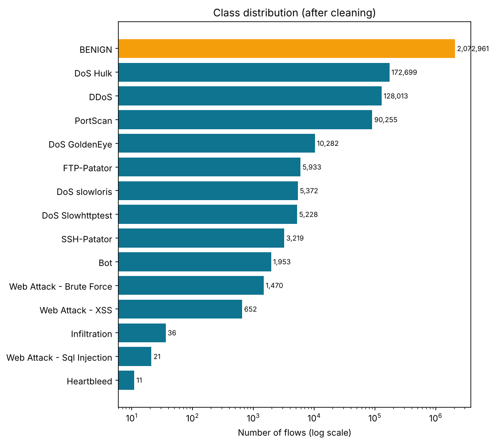

*Figure 1 — Class distribution after cleaning (log scale).* Three attack labels have tens of
flows, against two million benign flows. Per-class metrics for these labels rest on a handful of
test flows (Heartbleed 2, SQL injection 4, Infiltration 7), so they are reported but not
over-interpreted. The figure shows imbalance; it does not show how separable the classes are.

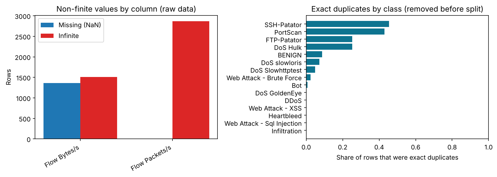

*Figure 2 — Data-quality issues.* `Flow Bytes/s` has 1,358 missing and 1,509 infinite values, and
`Flow Packets/s` has 2,867 infinite values. Both are rates computed with a zero flow duration.
331,200 rows (11.7 %) are exact duplicates. The duplicate share is highest for SSH-Patator (~45 %)
and PortScan (~43 %), whose tools generate identical short flows. Eight columns (bulk-rate and
some flag counts) are constant. Removing the duplicates matters most for exactly the classes
whose scores would otherwise be inflated.

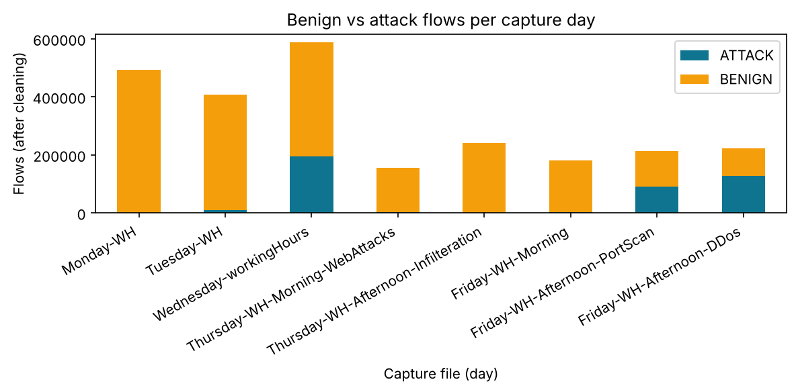

*Figure 3 — Benign and attack flows per capture day.* Attack traffic is concentrated on Wednesday
(DoS) and Friday afternoon (PortScan, DDoS); Monday is benign only. Because attack type and day
are confounded, a random split mixes days, which motivates the held-out-day test (§9.2).

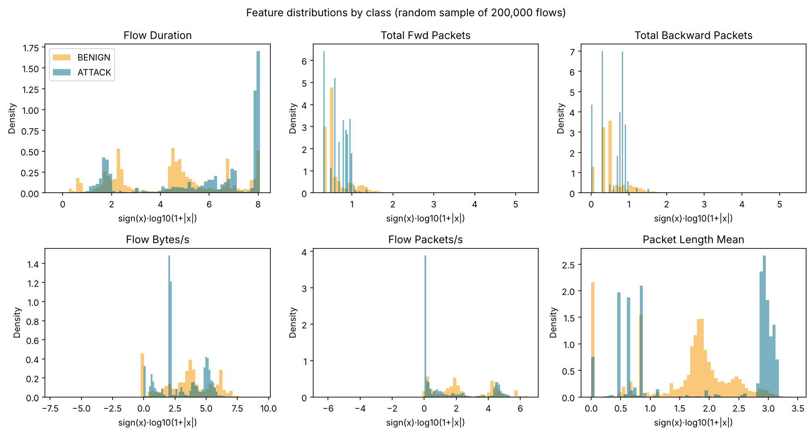

*Figure 4 — Log-transformed distributions of key features by class (200,000-flow sample).* Attack
flows cluster at specific values. For example, `Packet Length Mean` peaks near 1,000 bytes (DoS
flows) and near zero, and flow durations peak near the 120-second flow timeout. Benign
traffic is broad. Strong clustering suggests separability, but it partly reflects the fixed
behaviour of the attack tools used in the testbed.

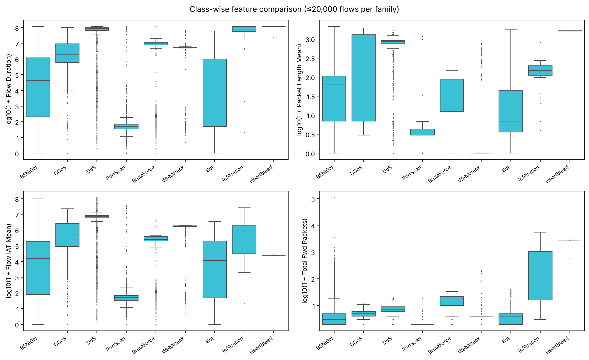

*Figure 5 — Feature ranges per attack family.* PortScan flows are very short with tiny packets.
DoS flows are long with large mean packet lengths. Brute-force and web-attack flows have narrow,
tool-specific ranges. Bot and benign ranges overlap widely, which anticipates Bot being the
hardest large family.

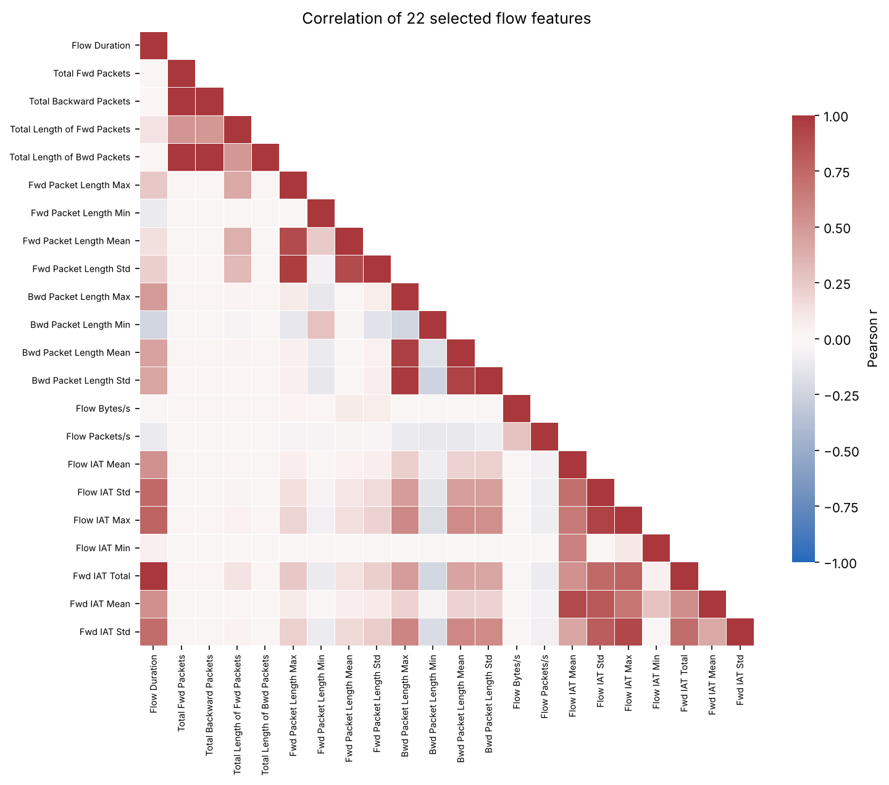

*Figure 6 — Pearson correlation of 22 flow features.* Strong blocks exist: forward and backward
packet counts with their byte totals, packet-length max/mean/std, and the inter-arrival-time
statistics with flow duration. Many features are near-duplicates, which justifies feature
selection and warns that importance is shared among correlated features.

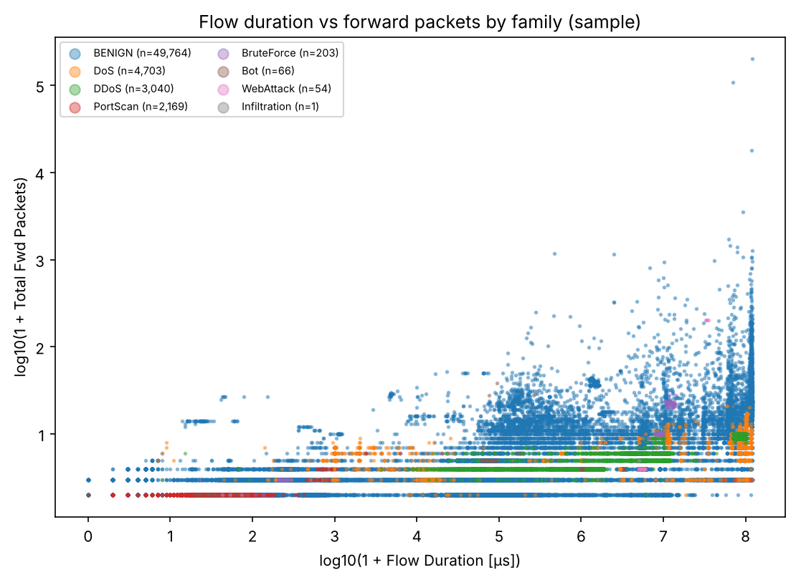

*Figure 7 — Flow duration against forward packets (sample).* PortScan occupies the
short-duration, one-to-two-packet corner, while DoS and DDoS form horizontal bands at low packet
counts across long durations. Most attack flows contain few packets, and benign traffic covers the
whole plane. Two features alone do not separate the classes.

---

## 4. Proposed methodology and system architecture

### 4.1 Overview
The system has two parts. An **offline training pipeline** (`src/train.py`) produces models,
metrics and figures. A **web application** (`app/app.py`) loads those artifacts for exploration
and prediction. Training and inference share the same feature schema and preprocessing pipeline
object, which guarantees identical treatment of inputs. *(See the architecture diagram in the README and `docs/architecture.drawio`.)*

### 4.2 Processing steps
1. Load all day files; strip header whitespace; drop the duplicated `Fwd Header Length` column
   after verifying it is identical; normalise label encodings.
2. Replace ±∞ with missing values; construct the binary and family targets.
3. Remove exact duplicate flows and flows whose identical features carry different labels.
4. Split 80/20, stratified on the fine-grained label (seed 42). Lock the test set.
5. Compare feature sets by cross-validation on a training subsample.
6. Tune five models by randomised search with stratified 3-fold CV (F1 of ATTACK).
7. Refit the best configuration of each model on the full training split; evaluate on test.
8. Choose the final model by CV score only.
9. Run error analysis, explainability, the family model and the held-out-day experiment; save the
   artifacts.

---

## 5. Data preprocessing and feature engineering

### 5.1 Cleaning decisions
| Issue | Decision | Rationale |
|---|---|---|
| Header whitespace, duplicated column, label encodings | Normalise; drop the verified duplicate | Consistent names and classes in training, the app and uploads |
| Infinite rates | Convert to missing → median imputation fitted on training data | Models cannot take ∞; the median is robust to heavy tails |
| Exact duplicate flows | Remove before the split | Prevents identical flows appearing in both train and test |
| Label-conflicting duplicates | Remove | Unlearnable; indicates label noise |
| Constant features | Removed inside the pipeline (variance threshold 0) | Learned from training data only |
| Skewed magnitudes (logistic regression only) | sign(x)·log(1+\|x\|), then standardisation | Comparable scales for a gradient-based, regularised model |

In total, 331,200 exact duplicates and 1,438 label-conflicting rows were removed (2,830,743 →
2,498,105 flows). The conflicts involved BENIGN (719), PortScan (564), DoS Hulk (150), DDoS (3)
and DoS slowloris (2). The stratified split produced 1,998,484 training and 499,621 test flows,
with an identical attack share of 17.02 % in both.

### 5.2 Why duplicates are removed but difficult samples are not
Duplicates are removed to prevent leakage across the split, not to make the task easier. No
sample was removed because it was hard to classify.

### 5.3 Splitting strategy and leakage control
The fine-grained label is used for stratification so that even classes with a handful of flows
appear in both partitions. All learned transformations are steps of a single scikit-learn
`Pipeline`, so cross-validation refits them in every fold, and the test set never influences
them. Resampling (SMOTE) is confined to training folds through an imbalanced-learn pipeline.
Model selection uses cross-validation scores only.

A random split evaluates recognition of *known* attack types. Because each attack in CIC-IDS2017
was executed on a particular day, a second **held-out-day** evaluation trains on Monday–Thursday
and tests on Friday. Friday's Bot, PortScan and DDoS traffic never appears in training.

### 5.4 Feature exclusions
`Destination Port` was excluded from model inputs. In the testbed, specific attacks were directed
at specific services, so the port is a likely spurious correlate [7] that would not transfer to
other networks. The capture-day file name is used only for bookkeeping, since it would reveal the
attack type.

### 5.5 Feature selection
Four candidate sets were compared by 3-fold CV F1 on a stratified training subsample: all eligible
features; a greedy correlation filter (|r| > 0.98); the top 30 by mutual information; and the top
30 by random-forest importance. The smallest set within 0.002 F1 of the best was chosen.
| Candidate set | Features | CV F1 | CV recall |
|---|---:|---:|---:|
| All eligible features | 76 | 0.9937 | 0.9908 |
| Correlation-filtered (\|r\| ≤ 0.98) | 48 | 0.9944 | 0.9920 |
| Top 30 by mutual information | 30 | 0.9930 | 0.9922 |
| **Top 30 by random-forest importance** | **30** | **0.9954** | **0.9942** |

The top-30 random-forest-importance set was both the best and among the smallest, so it was
chosen. It is dominated by packet-length statistics, followed by TCP window sizes, flag counts and
inter-arrival times. Removing redundant features slightly *improved* CV F1, which is consistent
with the redundancy seen in Figure 6.

---

## 6. Algorithms and mathematical foundations

### 6.1 Baseline
A majority-class classifier (always BENIGN) establishes the accuracy obtainable with no
detection ability at all.

### 6.2 Logistic regression
\(z=\beta_0+\sum_i\beta_i x_i\), \(P(y=1\mid x)=1/(1+e^{-z})\). The coefficients minimise
class-weighted binary cross-entropy
\(L=-\frac1N\sum_k w_{y_k}[y_k\log p_k+(1-y_k)\log(1-p_k)]+\frac{1}{2C}\lVert\beta\rVert^2\).
The model predicts ATTACK when \(p\ge0.5\), which is the same as \(z\ge0\). It is fast and
interpretable, but its decision boundary is linear in the transformed features.

### 6.3 Decision tree
Splits are chosen to maximise impurity reduction, with entropy \(H(S)=-\sum_i p_i\log_2p_i\),
information gain \(IG=H(S)-\sum_v\frac{|S_v|}{|S|}H(S_v)\) or Gini impurity
\(1-\sum_ip_i^2\). Depth and minimum leaf size are tuned to limit overfitting.

### 6.4 Random forest
Each tree is grown on a bootstrap sample with a random feature subset considered at each split.
scikit-learn averages the trees' class probabilities (soft voting),
\(P(\text{ATTACK}\mid x)=\frac1m\sum_jP_j(\text{ATTACK}\mid x)\), rather than taking a hard
majority vote. When fitting on millions of rows, each tree uses a bootstrap sample of at most
400,000 flows to bound memory and time.

### 6.5 Histogram gradient boosting
\(F_m(x)=F_{m-1}(x)+\eta h_m(x)\): shallow trees are added sequentially, each fitted to the
gradient of the log loss of the current ensemble. The learning rate \(\eta\), the maximum number
of leaves, L2 regularisation and early stopping control overfitting. Binning features into at
most 255 values makes training fast on large data.

### 6.6 Standardisation, class weighting and SMOTE
Standardisation \(z=(x-\mu)/\sigma\) uses training-set statistics only. Balanced class weights
are \(w_c=N/(K N_c)\). SMOTE generates
\(x_{new}=x_i+\lambda(x_j-x_i)\), \(\lambda\in[0,1]\), between a minority sample and one of its
nearest same-class neighbours. In this project it raises classes below 20,000 training rows to
that floor, and only within training folds.

### 6.7 Hyperparameter search
| Model | Search space |
|---|---|
| Logistic regression | C ∈ {0.01, 0.1, 1, 10} |
| Decision tree | max_depth ∈ {10, 20, none}; min_samples_leaf ∈ {1, 5, 20}; criterion ∈ {gini, entropy}; class_weight ∈ {none, balanced} |
| Random forest (100 trees) | max_depth ∈ {20, 30, none}; min_samples_leaf ∈ {2, 5, 10}; max_features ∈ {√p, 0.3}; class_weight ∈ {none, balanced_subsample} |
| Hist. gradient boosting | learning_rate ∈ {0.05, 0.1, 0.2}; max_leaf_nodes ∈ {31, 63, 127}; l2 ∈ {0, 1}; class_weight ∈ {none, balanced} |

---

## 7. Experimental setup
The reported run executed on a Lenovo LOQ laptop (Intel Core i5, 24 GB RAM, Windows 11) using Python 3.12.4,
scikit-learn 1.9.1, pandas 3.0.5, NumPy 2.5.3 and imbalanced-learn 0.14.2. The full run (loading,
EDA, tuning five models, final fits, explainability, family model and held-out-day experiment)
took 9.7 minutes. An independent run on a 2-core, 7.8 GB Linux machine (Python 3.13) produced the identical final model, confusion matrix and held-out-day results. Final models were fitted on **all 1,998,484
training flows**. Tuning used a 199,995-flow stratified subsample. Random seed 42 throughout. Tuning:
`RandomizedSearchCV`, stratified 3-fold CV on a training subsample of up to 200,000 flows (each
class keeps at least 2,000 flows or all of them). Scoring: F1 of ATTACK, with recall, precision
and specificity recorded. Decision threshold 0.5, fixed in advance.

---

## 8. Evaluation metrics
With ATTACK as the positive class: TP = attack detected; FN = attack missed; FP = benign flow
flagged (false alarm); TN = benign flow passed.

\(Accuracy=\frac{TP+TN}{TP+TN+FP+FN}\), \(Precision=\frac{TP}{TP+FP}\),
\(Recall=\frac{TP}{TP+FN}\), \(F1=\frac{2PR}{P+R}\), \(Specificity=\frac{TN}{TN+FP}\),
\(FPR=\frac{FP}{FP+TN}\), \(FNR=\frac{FN}{FN+TP}\).

ROC-AUC summarises the ranking quality across all thresholds. PR-AUC (average precision) is
preferred under class imbalance. For the family model, per-class scores and macro and weighted
averages are reported. Metrics with a zero denominator are reported as undefined, not as 0.
Accuracy alone is not used to judge models, because the majority-class baseline already scores
highly on it.

---

## 9. Results and comparative analysis
*Table 2 — Binary detection on the held-out test set (499,621 flows; 85,029 attacks).*

| Model | CV F1 | Train−CV gap | Accuracy | Precision | Recall | F1 | Specificity | FPR | FNR | ROC-AUC | PR-AUC | Fit (s) | Predict (ms/1k) |
|---|---:|---:|---:|---:|---:|---:|---:|---:|---:|---:|---:|---:|---:|
| Dummy (BENIGN) | 0.0000 | 0.0000 | 0.8298 | n/a | 0.0000 | 0.0000 | 1.0000 | 0.00000 | 1.0000 | n/a | n/a | 6.1 | 0.19 |
| Logistic Regression | 0.8545 | 0.0000 | 0.9407 | 0.7591 | 0.9542 | 0.8456 | 0.9379 | 0.06209 | 0.0458 | 0.9849 | 0.9368 | 35.5 | 0.64 |
| Decision Tree | 0.9952 | 0.0040 | 0.9991 | 0.9955 | 0.9990 | 0.9972 | 0.9991 | 0.00094 | 0.0010 | 0.9994 | 0.9980 | 37.4 | 0.27 |
| **Random Forest** | 0.9957 | 0.0027 | 0.9990 | 0.9964 | 0.9977 | 0.9970 | 0.9993 | 0.00074 | 0.0023 | 0.99996 | 0.99985 | 27.7 | 0.87 |
| HistGradientBoosting | 0.9963 | 0.0020 | 0.9991 | 0.9971 | 0.9976 | 0.9973 | 0.9994 | 0.00059 | 0.0024 | 0.99998 | 0.99992 | 20.9 | 1.71 |

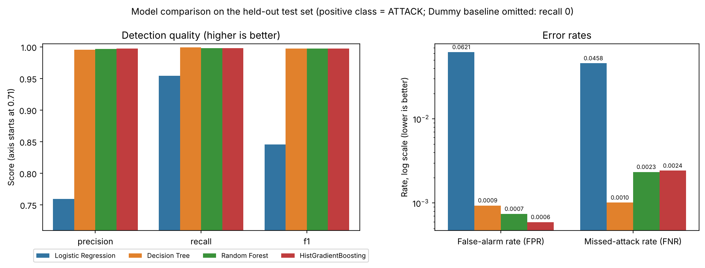

*Figure 8 — Detection quality and error rates (log scale).*

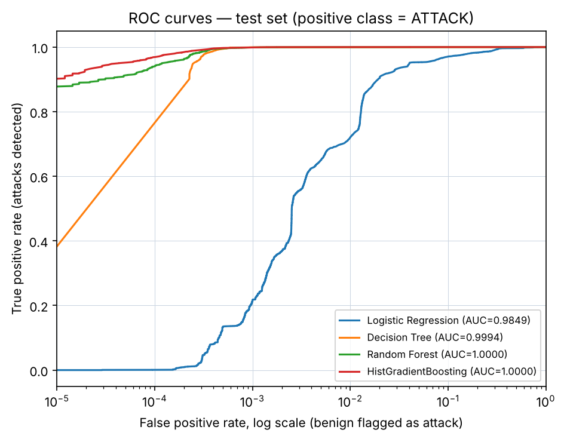 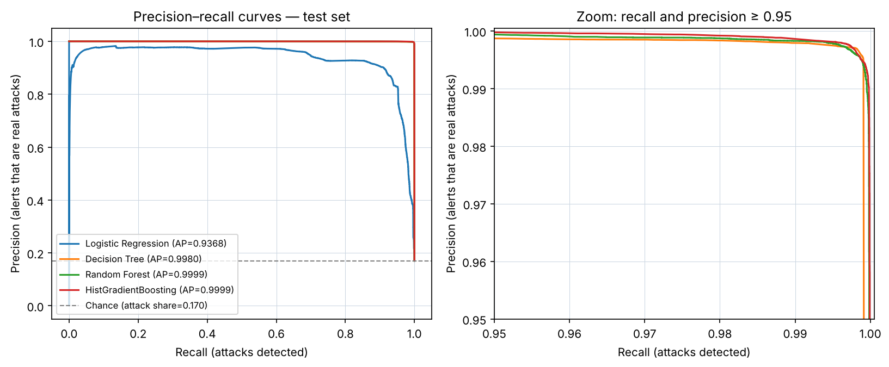

*Figures 9–10 — ROC curves on a logarithmic false-positive axis, and precision–recall curves
with a zoom panel.*

*Figure 11 — Final model confusion matrix: 99.93 % of benign flows passed (308 false alarms) and
99.77 % of attacks detected (199 missed).*

**Baseline.** Always predicting BENIGN gives 83.0 % accuracy with zero recall. This confirms
that accuracy cannot be the selection metric.

**Linear versus non-linear.** Logistic regression reaches a ROC-AUC of 0.985, so it ranks attacks
reasonably well. But at the 0.5 threshold it raises a false alarm on 6.2 % of benign traffic (25,743
flows), about 80 times the tree models' rate. Its training and validation F1 are identical
(0.855), which is the signature of underfitting: the classes are not linearly separable even
after log-scaling. Attack signatures in flow data are threshold-like and interacting (short
duration *and* tiny packets *and* a particular window size), which trees capture naturally.

**Single tree versus ensembles.** The decision tree is already strong (F1 0.9972) and has the
lowest miss rate. However, it raises 26 % more false alarms than the random forest (388 vs 308)
and shows the largest train–validation gap (0.0040), consistent with a single tree's higher
variance. The ensembles have the best ranking quality (ROC-AUC ≈ 0.99996–0.99998, PR-AUC
≈ 0.9999), so their thresholds can be moved with little loss. On the log-scale ROC (Figure 9),
gradient boosting retains about 90 % detection even at a 0.001 % false-alarm rate.

**Final choice.** Random Forest and HistGradientBoosting were within the predefined 0.001 CV-F1
tie margin (0.9957 vs 0.9963). Random Forest had the higher CV specificity, so it was chosen,
without consulting the test set. On the test set the two are practically indistinguishable
(gradient boosting: 62 fewer false alarms and 7 more misses out of half a million flows).
Gradient boosting is a reasonable alternative, being faster to train and smaller (0.9 MB versus
14.3 MB uncompressed). Random Forest predicts faster, at 0.9 ms versus 1.7 ms per 1,000 flows on the laptop.
All tree models' train–validation gaps are below 0.005, so overfitting on this split is small.

### 9.1 Attack-family classification
| Imbalance strategy (CV on training subsample) | Macro-F1 | Weighted-F1 | Balanced accuracy |
|---|---:|---:|---:|
| None | 0.9397 | 0.9956 | 0.9302 |
| Class weights (balanced_subsample) | 0.9397 | 0.9956 | 0.9302 |
| **SMOTE inside training folds (floor 20,000)** | **0.9539** | 0.9936 | **0.9688** |

| Family (test) | Precision | Recall | F1 | Test flows |
|---|---:|---:|---:|---:|
| BENIGN | 0.9997 | 0.9985 | 0.9991 | 414,592 |
| DoS | 0.9960 | 0.9975 | 0.9968 | 38,716 |
| DDoS | 0.9996 | 0.9990 | 0.9993 | 25,603 |
| PortScan | 0.9953 | 0.9996 | 0.9974 | 18,051 |
| BruteForce | 0.9956 | 0.9967 | 0.9962 | 1,831 |
| WebAttack | 0.9816 | 0.9953 | 0.9884 | 428 |
| Bot | 0.5189 | 0.9821 | 0.6790 | 391 |
| Infiltration | 0.7143 | 0.7143 | 0.7143 | 7 |
| Heartbleed | 1.0000 | 0.5000 | 0.6667 | 2 |
| **Macro / weighted average** | 0.9112 / 0.9988 | 0.9092 / 0.9985 | **0.8930 / 0.9986** | 499,621 |

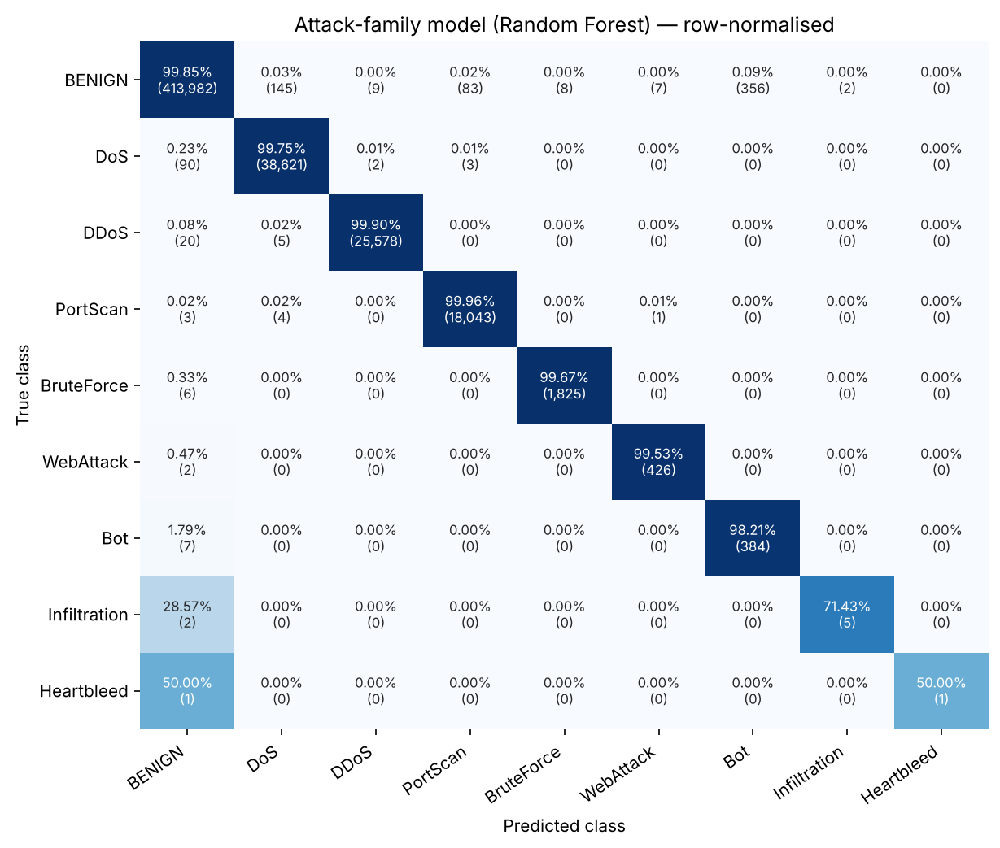

*Figure 12 — Row-normalised family confusion matrix.*

In-fold SMOTE raised CV macro-F1 and balanced accuracy, so it was selected. The weighted-F1 of
0.9986 hides weak classes: the macro-F1 is only 0.893. SMOTE raised Bot recall to 98 %, but
**356 benign flows were labelled Bot**, giving a Bot precision of 0.52. The synthetic Bot points
fall into regions of benign traffic, which matches the overlap seen in Figure 5. Infiltration and
Heartbleed are misclassified as BENIGN in 2 of 7 and 1 of 2 cases. With so few examples (11 and 36
flows in the whole dataset) these per-class figures are anecdotal. Confusions among the large
attack families are below 0.03 %.

### 9.2 Held-out-day generalisation
The same random-forest configuration was retrained on all Monday–Thursday flows (1,882,812) and
tested on all Friday flows (615,293). Friday's attacks are Bot, PortScan and DDoS, none of which
occur earlier in the week.

| Evaluation | Recall | Precision | FPR | F1 | ROC-AUC |
|---|---:|---:|---:|---:|---:|
| Random split (Table 2) | 0.9977 | 0.9964 | 0.00074 | 0.9970 | 0.99996 |
| **Held-out Friday** | **0.1014** | 0.9951 | 0.00028 | 0.1841 | 0.7680 |

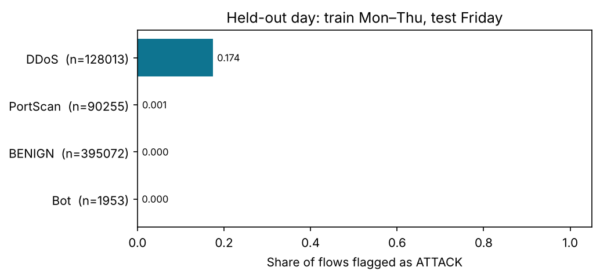

*Figure 13 — Share of Friday flows flagged, per label.* DDoS 17.4 %, PortScan 0.07 %, Bot 0 %,
benign 0.03 %.

This is the central result of the project. The model detects attack types it has seen almost
perfectly, but it detects only a tenth of attacks of new types. It stays highly precise and
almost never raises false alarms, which means it has learned "what DoS, brute force and web
attacks from these tools look like", not "what malicious traffic looks like". The partial DDoS
detection probably comes from its similarity to Wednesday's DoS flows. Sommer and Paxson [6] and
Arp et al. [7] warn about exactly this closed-world limitation. Random-split scores on
CIC-IDS2017, including the 99.7 % here, should not be read as evidence of protection against novel
attacks.

---

## 10. Error analysis and explainability

### 10.1 Error analysis
**Missed attacks (199).** By count: DoS Hulk 61, Bot 59, DDoS 20, SSH-Patator 11, DoS GoldenEye
10, and smaller numbers for the remaining labels. By rate, the rarest classes fare worst: all 4
SQL-injection test flows, 5 of 7 Infiltration flows, 1 of 2 Heartbleed flows and 15 % of Bot flows
were missed. Detection is at least 99.2 % for DoS, DDoS, PortScan and brute force, and 96.7 % for
web attacks (Figure 14). Engelen et al. [4] likewise report a random-forest F1 of 0.11 for SQL
injection on the original data.

*Figure 14 — Share flagged as ATTACK per family (test set).*

**What errors look like.** The missed attacks are mostly borderline: the median P(attack) is 0.36,
and 90 % are below 0.48. Their top-feature values resemble benign traffic, with an average packet
size of 3 bytes and zero backward packet-length standard deviation, i.e. near-empty flows. The 308 false
alarms are the mirror image: benign flows with a median average packet size of 3 bytes (versus
78.5 for correctly passed benign traffic) and packet-length variance 5 (versus 945). Near-empty
flows are intrinsically ambiguous, and Engelen et al. [4] found many such flows in CIC-IDS2017 to
be labelling or flow-construction artefacts.

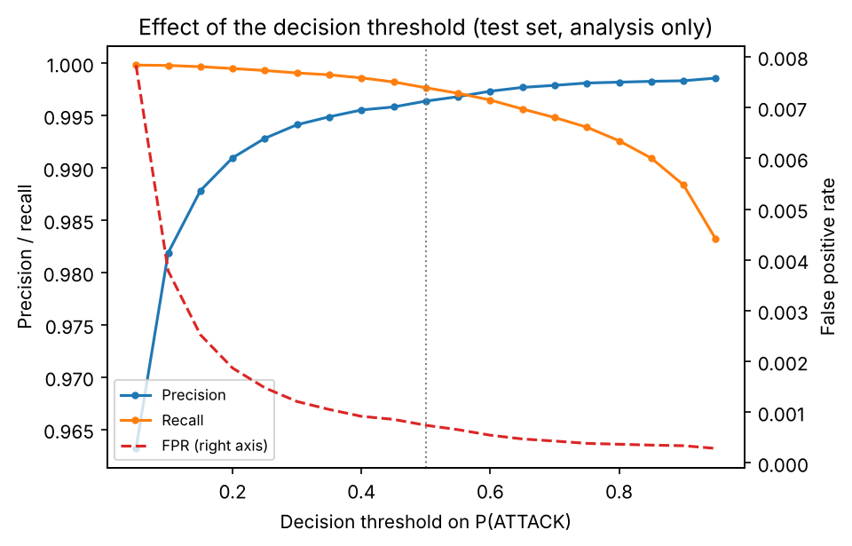

*Figure 15 — Precision, recall and FPR versus the decision threshold (analysis only).* Lowering
the threshold from 0.5 to 0.3 would raise recall from 99.77 % to 99.91% and FPR from 0.074 % to
0.12 %. At 0.1, recall reaches 99.98 % but FPR rises to 0.38 %. The threshold was fixed at 0.5 in
advance. In deployment it should be chosen on validation data from the relative cost of a missed
attack and an analyst's time per false alarm.

### 10.2 Explainability
| Rank | Permutation importance (drop in test F1) | Built-in (impurity) | SHAP mean \|value\| |
|---:|---|---|---|
| 1 | PSH Flag Count (0.040) | Packet Length Variance | Bwd Packet Length Std |
| 2 | Init_Win_bytes_forward (0.032) | Bwd Packet Length Std | Init_Win_bytes_backward |
| 3 | Flow Bytes/s (0.028) | Average Packet Size | Packet Length Variance |
| 4 | Init_Win_bytes_backward (0.021) | Packet Length Std | Subflow Bwd Bytes |
| 5 | Fwd IAT Min (0.013) | Max Packet Length | Average Packet Size |

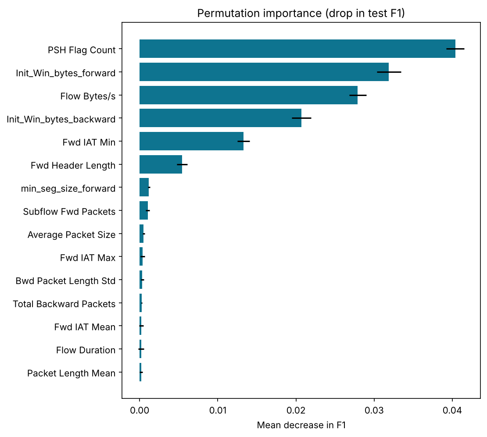 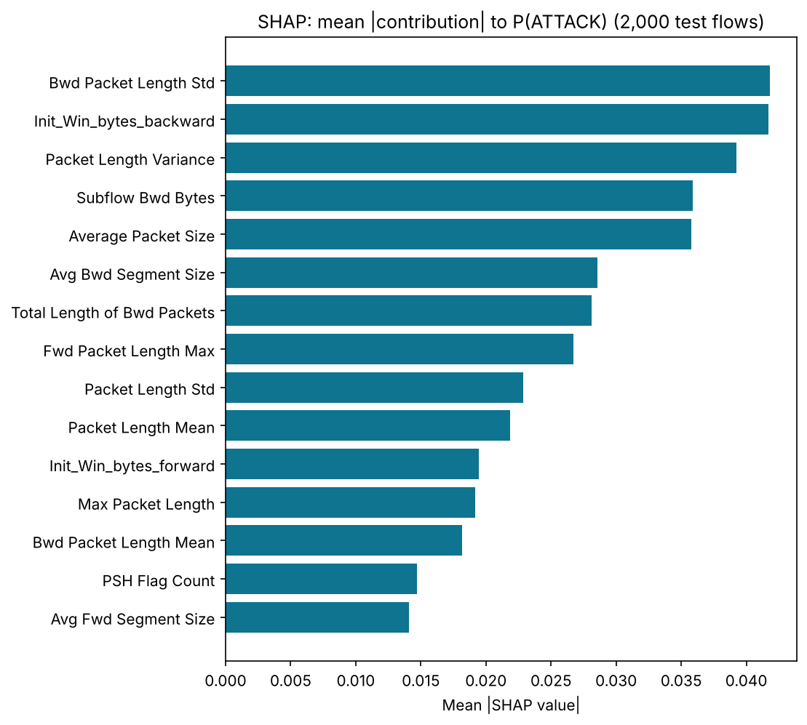

*Figures 16–17 — Permutation importance on 20,000 test flows (5 repeats) and SHAP importance on
2,000 test flows.*

The methods agree on two groups: packet-length statistics, and the TCP initial window sizes. They
disagree on order because the many correlated packet-length features share impurity and SHAP
credit. Shuffling any single one of them barely hurts F1, since its near-copies remain. So
permutation importance ranks the less redundant PSH-flag and window features higher. The
window-size features reflect the operating-system settings of the testbed's attacker and victim
machines. Their high importance is a warning sign of a dataset-specific shortcut [4], [7], not a
general property of attacks. These rankings describe what the model relies on, not what causes an
attack, and they do not prove any individual prediction correct.

---

## 11. Website design and implementation
The Streamlit application has seven pages: Dashboard, Dataset explorer, Model performance,
Intrusion detection, Explainability, Methodology and About & limitations. It only reads the
artifacts written by training (pipeline, schema, metadata, result files, figures). It never
trains a model and contains no hard-coded results.

On the detection page, uploaded files are parsed as CSV only and never deserialised as Python
objects. The required columns are checked by name, and column order does not matter. Extra
columns are ignored and reported, and a `Label` column, if present, is shown only for
comparison. Non-numeric values produce errors that name the column. Infinity is treated as
missing, exactly as in training. There are row and size limits. An input-realism check then compares
the records with the training data. It warns when a file does not resemble real CICFlowMeter
traffic, for example values outside the training range such as a `PSH Flag Count` other than 0 or
1, or many features in the extreme 1 % tails. It flags 2 of 499,621 real test flows but 72 of 100
hand-generated rows, whose predictions would otherwise look like confident model output. Results show the number of flows
flagged, the distribution of P(attack), an optional family estimate and a CSV download. The
single-flow form starts from training medians, applies the same check, and explains the prediction with SHAP (tree models) or exact coefficient contributions
(logistic regression). Every page states that the tool performs offline analysis and that its
outputs are model estimates. Screenshots are in `docs/screenshots/`.

---

## 12. Testing and validation
An automated pytest suite (108 tests) verifies:
- data loading and target detection; header, duplicate-column and label normalisation;
- infinite/missing value handling; de-duplication of exact and label-conflicting rows;
- that no flow appears in both train and test, and that the split is stratified;
- leakage guards: scaler statistics equal to training statistics, SMOTE only inside training
  folds, excluded and bookkeeping columns never used as features;
- removal of constant features; save/reload with identical predictions;
- prediction shape, label validity and probability range, and invariance to column order;
- the metric label mapping, and undefined metrics reported as undefined;
- CSV validation (missing, extra, non-numeric, Infinity, empty and oversized input);
- the input-realism check (typical rows pass; a non-0/1 flag or an out-of-range value is flagged;
  the real demo sample raises no warning);
- an end-to-end run that trains on a synthetic fixture in the CIC-IDS2017 format and executes
  every website page, including the demo prediction.

A full-size rehearsal on 2.8 million synthetic rows was run before training on the real data. It
exposed and led to fixes for memory overflows (dtype handling in the log transform, SMOTE target
size, random-forest tree size) and a model-serialisation fault. After the fixes, the full run took 20.5 minutes on the 2-core machine (peak memory 4.25 GB) and 9.7 minutes on the laptop. Reloading the
saved models and re-deriving the split reproduced every test count exactly
(`scripts/regenerate_figures.py` checks this), which confirms that the pipeline is
deterministic.

---

## 13. Limitations, ethics and responsible use

**Limitations.** The data is laboratory traffic from 2017 and contains documented labelling
errors [4], [5]. Attack types are confounded with capture days. Random-split scores measure
recognition of known attacks. Inputs must be CICFlowMeter features. The system works offline
only. Explanations are model descriptions, not causal evidence.

**Ethics.** Only authorised data should be analysed. Flow records can reveal user behaviour, so
data minimisation and access control matter. False positives can burden or wrongly implicate
users. False negatives can give a false sense of security. The tool is therefore positioned as a
decision aid with visible disclaimers. No raw traffic is committed to the repository.

**SDG alignment.** The project contributes, as a learning prototype, toward SDG 9 (resilient
digital infrastructure, through research into ML-assisted detection) and SDG 16 (safer digital
environments). It does not claim measurable impact on these goals.

---

## 14. Conclusion and future scope
NetGuard AI shows that a carefully built, leak-free pipeline of classical models can separate
benign from malicious CIC-IDS2017 flows almost perfectly when the attack types are known. A random
forest on 30 selected features detected 99.77 % of 85,029 test attacks with a 0.074 % false-alarm
rate, far beyond a majority baseline (zero detection at 83 % accuracy) and a linear model (6 %
false alarms). The same model detected only 10.1 % of attacks of unseen types on a held-out day.
Rare classes (SQL injection, Infiltration, Heartbleed) remain unreliable, and the most influential
features include likely testbed artefacts. The project's main contribution is therefore not the
headline score but a reproducible system that measures, explains and openly reports where
flow-based ML detection can and cannot be trusted. It comes with an interactive tool for offline
analysis.

Future work: live flow extraction with CICFlowMeter feeding the model; evaluation on newer and
corrected datasets, including cross-dataset testing; drift monitoring; thresholds chosen from
analyst-defined costs; probability calibration; and anomaly-detection components for unseen
attacks.

---

## References
[1] D. E. Denning, "An Intrusion-Detection Model," *IEEE Trans. Software Engineering*, vol.
SE-13, no. 2, pp. 222–232, 1987.
[2] M. Ring, S. Wunderlich, D. Scheuring, D. Landes, A. Hotho, "A survey of network-based
intrusion detection data sets," *Computers & Security*, vol. 86, pp. 147–167, 2019.
[3] I. Sharafaldin, A. H. Lashkari, A. A. Ghorbani, "Toward Generating a New Intrusion Detection
Dataset and Intrusion Traffic Characterization," *Proc. ICISSP*, 2018, pp. 108–116,
doi:10.5220/0006639801080116.
[4] G. Engelen, V. Rimmer, W. Joosen, "Troubleshooting an Intrusion Detection Dataset: the
CICIDS2017 Case Study," *IEEE Security and Privacy Workshops*, 2021,
doi:10.1109/SPW53761.2021.00009.
[5] M. Lanvin, P.-F. Gimenez, Y. Han, F. Majorczyk, L. Mé, É. Totel, "Errors in the CICIDS2017
Dataset and the Significant Differences in Detection Performances It Makes," *CRiSIS 2022*, LNCS
13857, Springer, 2023, pp. 18–33, doi:10.1007/978-3-031-31108-6_2.
[6] R. Sommer, V. Paxson, "Outside the Closed World: On Using Machine Learning for Network
Intrusion Detection," *IEEE Symposium on Security and Privacy*, 2010, pp. 305–316.
[7] D. Arp et al., "Dos and Don'ts of Machine Learning in Computer Security," *USENIX Security
Symposium*, 2022.
[8] L. Breiman, "Random Forests," *Machine Learning*, vol. 45, no. 1, pp. 5–32, 2001.
[9] N. V. Chawla, K. W. Bowyer, L. O. Hall, W. P. Kegelmeyer, "SMOTE: Synthetic Minority
Over-sampling Technique," *JAIR*, vol. 16, pp. 321–357, 2002.
[10] S. M. Lundberg, S.-I. Lee, "A Unified Approach to Interpreting Model Predictions," *NeurIPS*,
2017.
[11] F. Pedregosa et al., "Scikit-learn: Machine Learning in Python," *JMLR*, vol. 12,
pp. 2825–2830, 2011.

## Appendix
A. Reproduction commands (README). B. Full hyperparameter search results
(`reports/results/cv_search_*.csv`). C. Test-suite listing (`tests/`).
